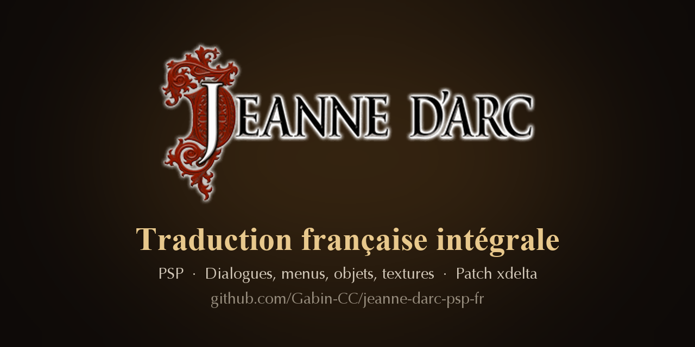
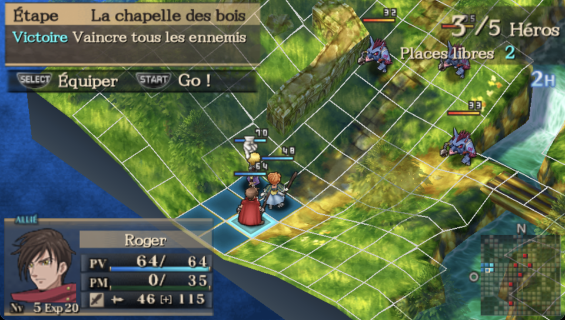
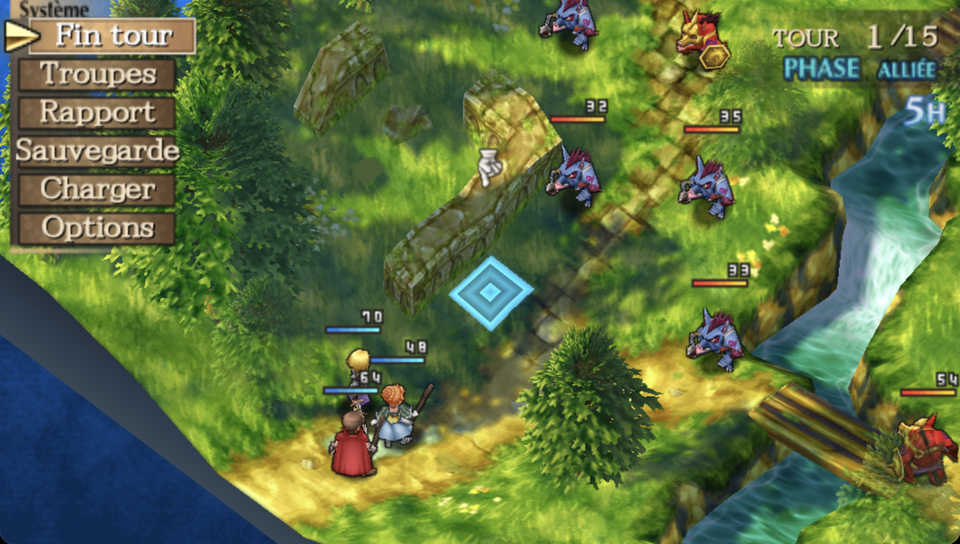
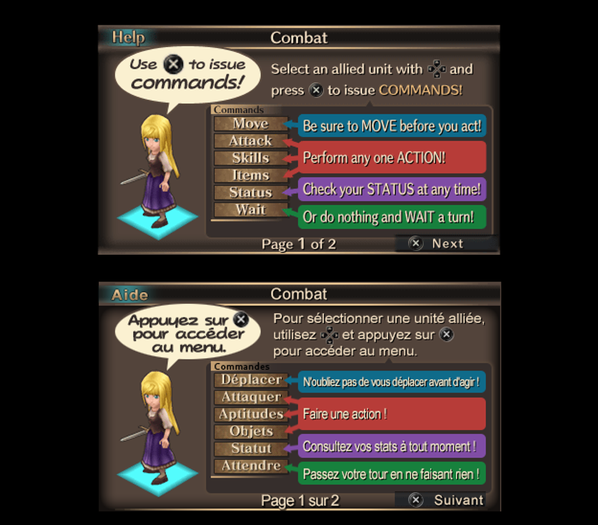

<p align="center"></p>

<p align="center">
  <a href="https://github.com/Gabin-CC/jeanne-darc-psp-fr/releases/latest"></a>
  <a href="https://github.com/Gabin-CC/jeanne-darc-psp-fr/releases"></a>
  
</p>

# Jeanne d'Arc (PSP) — Traduction française

**👉 [Télécharger le patch](https://github.com/Gabin-CC/jeanne-darc-psp-fr/releases/latest)** — instructions d'installation [plus bas](#installer-le-patch-joueurs).

Traduction amateur intégrale en français de **Jeanne d'Arc** (Level-5, PSP, 2007), à partir de la
version américaine. Les dialogues et les graphismes sont l'œuvre de l'équipe **PSP Traduction**
(voir [Crédits](#crédits)). Le jeu n'est jamais sorti officiellement en français (la réédition PS4/PS5 de
2024 est en anglais et en japonais uniquement).

> *Fan translation of the PSP game Jeanne d'Arc into French. Apply the `.xdelta` patch from the
> Releases page to your own dump of the US version (ULUS-10261).*

## Ce qui est traduit

| | |
|---|---|
| Dialogues (toute l'histoire, colisée et stages annexes) | ✅ ~6 100 répliques, traduction de l'équipe PSP Traduction |
| Objets, armes, armures, sorts, compétences et descriptions | ✅ |
| Menus, sauvegarde, options, aide textuelle | ✅ |
| Titres de chapitres, objectifs, noms de lieux, carte du monde | ✅ |
| Textures : écran titre, interface de combat, menus, bandeaux de lieux, cartons de chapitre, bannières de compétences | ✅ |
| Pages d'aide illustrées (`HELP/*.GIM`) | ✅ les 35 pages |
| Vidéos | ✅ sous-titrées (20 cinématiques) |

Partis pris de traduction :
- noms historiques et géographiques sous leur forme française (Domrémy, Orléans, duc de Bourgogne…),
  sauf les rois anglais qui gardent leur nom (Henry V, Henry VI) ;
- les tics de langage des personnages sont conservés (La Hire roule les r, Rufus remplace ses consonnes par des R, les nains zozotent…) ;
- la carte parchemin du monde garde ses inscriptions d'origine.

Le glossaire complet est dans [`trad/glossaire.md`](trad/glossaire.md).

## Aperçu

| Préparation de la bataille | Menu de combat |
|---|---|
|  |  |

Les textures elles aussi sont traduites — exemple avec une page d'aide (en haut l'original, en bas la version française) :

<p align="center"></p>

## Installer le patch (joueurs)

1. Il vous faut **votre propre** image ISO de la version US (*Jeanne d'Arc*, ULUS-10261) :
   - MD5 attendu : `306f1eb4c983a555f3b548ad7c09386e`
2. Téléchargez `Jeanne_dArc_FR.xdelta` depuis la page **Releases** du dépôt.
3. Appliquez le patch avec l'un de ces outils :
   - en ligne, sans installation : [Rom Patcher JS](https://www.marcrobledo.com/RomPatcher.js/) ;
   - Windows : *xdelta UI* ou *Delta Patcher* ;
   - ligne de commande : `xdelta3 -d -s "Jeanne d'Arc (USA).iso" Jeanne_dArc_FR.xdelta "Jeanne d'Arc (FR).iso"`
4. Vérifiez le résultat — MD5 de l'ISO français : `ff0cbd643a58e71aa5dbb3f4fddacb2d` (v1.0.1).

Compatible **PPSSPP** et **PSP avec custom firmware** (l'exécutable est fourni déchiffré).

> ⚠️ Sur PPSSPP, ne chargez pas un *savestate* créé avec une autre version de l'ISO : il restaure
> la mémoire de l'ancienne version (textes et textures anglais). Les sauvegardes faites dans le jeu
> fonctionnent sans problème.

## Limites connues

- La police système de la PSP n'a pas de tiret court : les traits d'union utilisent le caractère
  U+2012, le plus fin disponible.

## Reconstruire le patch depuis les sources

Prérequis : Python 3.10+, `xdelta3`, et **macOS** pour les textures (les noms de la carte du monde
sont rendus avec la police système Optima — voir `tools/gimtext.py`).

```sh
python3 -m venv .venv && .venv/bin/pip install -r requirements.txt

# 1. Placer "Jeanne d'Arc (USA).iso" à la racine du dépôt, puis l'extraire
.venv/bin/python tools/iso_extract.py "Jeanne d'Arc (USA).iso" extract

# 1 bis. Vidéos sous-titrées de l'équipe PSP Traduction (non versionnées : contenu du jeu)
#        à partir de leurs quatre patchs alpha de 2013 (patch-alpha-*.xdelta), joints à la Release
.venv/bin/python tools/import_equipe2013.py dossier/des/patchs

# 2. Vérifier les traductions puis construire "Jeanne d'Arc (FR).iso"
.venv/bin/python tools/check_trad.py
.venv/bin/python tools/build.py

# 3. Générer le patch
xdelta3 -e -9 -S none -s "Jeanne d'Arc (USA).iso" "Jeanne d'Arc (FR).iso" Jeanne_dArc_FR.xdelta   # -S none : compatible Rom Patcher JS
```

## Organisation

```
trad/                  tout ce qui est traduit (c'est ici qu'on corrige)
  dialogues/NNN.json   dialogues, dans l'ordre de l'histoire
                       {ctx: script source, max: largeur, who: locuteur, en, fr, src, relu}
  logic.json           objets, sorts, compétences, ennemis (champs de taille fixe, max = octets)
  cartes.json          titres de chapitres, objectifs, noms d'unités
  menus.json           textes de l'exécutable (menus, sauvegarde…)
  interface.json       libellés d'interface et noms de lieux de la carte du monde
  raven/               textures (gim/, gmo/) et pages d'aide (help/*.png) de Raven
  equipe2013/          de l'ISO de l'équipe : MENU_03, MENU_TEX, PIC1 (fond du menu PSP),
                       ICONPACK (icônes de sauvegarde), vidéos *.PMF (non versionnées)
  images.json          nos retouches de textures restantes (carte du monde, icônes)
  glossaire.md         noms, termes, tutoiement/vouvoiement, règles de style
  termes_logic.md      noms officiels des objets, sorts et compétences
tools/
  build.py             construit l'ISO français (point d'entrée)
  check_trad.py        vérifie longueurs de ligne, codes de contrôle, octets
  iso_extract.py       extrait l'ISO US (nécessaire au build)
  import_equipe2013.py récupère les vidéos sous-titrées depuis les patchs 2013 de l'équipe
  iso_patch.py         réécriture de l'ISO + table FILEINFO.DAT du jeu
  jda_event.py         format des scripts de dialogue (EVENT/ST*.BIN)
  jda_fixed.py         chaînes en champs de taille fixe ; extract_fixed.py : leurs emplacements
  build_images.py      textures : celles de Raven et de l'équipe + nos retouches
  gim.py               lecture/écriture des textures GIM de la PSP
  gimtext.py, gimwm.py rendu du texte français dans les textures (icônes, carte du monde)
docs/                  images du README
```

### D'où vient quoi

| Contenu | Source |
|---|---|
| Dialogues | équipe PSP Traduction (Pinky & Bleachy), `src: "pinky"` ; relecture orthographique `relu: true` ; quelques répliques absentes de leurs scripts traduites par nous (`src: "ia"`) |
| Textures, bandeaux, pages d'aide | Raven (équipe PSP Traduction), `trad/raven/` |
| Vidéos sous-titrées, écrans NIVEAU FINI / NIVEAU + !, fond du menu PSP, icônes de sauvegarde | ISO patché de l'équipe du 12/04/2013, `trad/equipe2013/` |
| Objets, sorts, menus, cartes, carte du monde | ce dépôt, vocabulaire aligné sur celui de l'équipe |

### Notes techniques

- Les dialogues sont dans `EVENT/ST*.BIN` : en-tête, table d'offsets relatifs, bytecode, puis bloc de
  texte Latin-1. Les caractères hors Latin-1 (œ, —, ‒) passent par des échappements `\uXXXX` que le
  moteur interprète.
- Le jeu lit ses fichiers par LBA via `USRDIR/DATA/FILEINFO.DAT` : les fichiers agrandis sont
  déplacés en fin d'image et la table est mise à jour. Les copies d'un même fichier dans les
  dossiers `ASxxxx/` sont toutes patchées.

## Contribuer

Les corrections sont les bienvenues (coquilles, tournures, débordements à l'écran) :

1. Modifiez le champ `fr` dans le fichier JSON concerné (ne touchez pas à `en`).
2. Respectez [`trad/glossaire.md`](trad/glossaire.md) et conservez les codes `\n`, `\f`, `%d`, `\uXXXX`.
3. Lancez `tools/check_trad.py` : il doit afficher 0 erreur.
4. Ouvrez une *pull request*, idéalement avec une capture d'écran.

Pour signaler un problème en jeu, ouvrez une *issue* avec une capture et le contexte (chapitre, scène).

## Crédits

**Équipe PSP Traduction** — traduction des dialogues : Pinky & Bleachy ; graphismes : Raven ;
avec Lyan, Alb_à_tort, Loki, Mardhor, Messis et BahaBulle.
<!-- À compléter avec les rôles confirmés par Pinky avant la fusion dans main. -->

Intégration, outils, objets/menus et relecture : ce dépôt.

## Licences et mentions légales

- Code (`tools/`) : licence [MIT](LICENSE).
- Traductions et fichiers de `trad/` : [CC BY 4.0](LICENSE-TRADUCTION.md).

*Jeanne d'Arc* est une marque et une œuvre de Level-5 Inc. et Sony Interactive Entertainment. Ce
projet amateur n'est ni affilié ni approuvé par eux. Aucune donnée du jeu (ISO, fichiers extraits)
n'est distribuée : il faut posséder le jeu. Les fichiers de traduction contiennent le texte anglais
d'origine à titre de référence pour les traducteurs.
